<div align="center">




<p>
  <a href="https://anurag-six.vercel.app/"></a>
  <a href="https://linkedin.com/in/anurag-verma4"></a>
  <a href="https://github.com/Anu7276"></a>
  
</p>


</div>



## Most people *use* AI.<br>I teach it to **take action.** ⚡

I'm **Anurag**, a B.Tech CSE (AI) student at Parul University who got tired of chatbots that only *talk*. So I build agents that **read pitch decks, verify insurance claims, run interviews, and control my actual computer.**

I take ideas from a messy 2 AM sketch to a **deployed, demo-able product**, and I compete to prove it works: **Top 7% globally** on HackerRank Orchestrate, **CodeChef Gold**, and a few national hackathons deep.

```js
const anurag = {
  building:     ["Startup-AYUSH Portal", "CAMPAIGNIX", "VIVORA", "agents that actually do things"],
  obsessedWith: ["multi-agent orchestration", "RAG that doesn't hallucinate"],
  fuel:         ["curiosity", "caffeine", "deadlines"],
  habitat:      "the agent squad HQ ⚡",
  motto:        "If it can't be demoed, it isn't done.",
  status:       "open to the right opportunity 🚀"
};
```

🌐 **Portfolio:** [anurag-six.vercel.app](https://anurag-six.vercel.app/)

**Currently focused on:** AI agent orchestration (Groq + Gemini), RAG systems, and full-stack development with the MERN stack.

<div align="center">



</div>


<div align="center">


| ⭐ | What I did | Proof |
|:---:|---|---|
| 🏆 | Ranked **#119 of 1,773** worldwide in a multimodal AI challenge | HackerRank Orchestrate, June 2026 |
| 💯 | Hit **100% accuracy** on an insurance-claim verification pipeline | Led to direct outreach from HackerRank |
| 🗣️ | Built an AI that **interviews founders by voice** and scores their pitch | SIH1345, Startup-AYUSH Portal |
| 🖥️ | Gave my personal AI **hands**: it controls a real Windows machine | Maya |
| 🎲 | Built the same multiplayer game **twice** on purpose, just to compare architectures | Ludo + Snake & Ladder |

</div>


<div align="center">

<a href="https://sih-hackathon-internal.vercel.app/"></a>

[🔗 Live Demo](https://sih-hackathon-internal.vercel.app/) · [💻 GitHub Repo](https://github.com/Anu7276/SIH-hackthon-INTERNAL-)

<table>
<tr>
<td width="50%" align="center">
<sub>🏆 HackerRank Orchestrate · Top 7% Globally</sub>
</td>
<td width="50%" align="center">
<a href="https://github.com/Anu7276/maya"></a>
<sub><a href="https://github.com/Anu7276/maya">💻 GitHub Repo</a></sub>
</td>
</tr>
<tr>
<td width="50%" align="center">
<a href="https://github.com/Anu7276/VIVORA"></a>
<sub><a href="https://github.com/Anu7276/VIVORA">💻 Core Repo</a> · <a href="https://github.com/Anu7276/vivora-frontend">🖥️ Frontend</a></sub>
</td>
<td width="50%" align="center">
<a href="https://github.com/pranav2312-cmd/Campaignix"></a>
<sub><a href="https://github.com/pranav2312-cmd/Campaignix">💻 GitHub Repo</a></sub>
</td>
</tr>
</table>

</div>

<details>
<summary><b>🗺️ Open Quest Archive — 5 More Animated Quest Cards</b></summary>

<div align="center">
<table>
<tr>
<td width="50%" align="center">
<a href="https://github.com/Anu7276/community-hero"></a>
<sub><a href="https://github.com/Anu7276/community-hero">💻 GitHub Repo</a></sub>
</td>
<td width="50%" align="center">
<a href="https://github.com/Anu7276/ai-support-triage-pro-hackerRank-hackthon-"></a>
<sub><a href="https://github.com/Anu7276/ai-support-triage-pro-hackerRank-hackthon-">💻 GitHub Repo</a></sub>
</td>
</tr>
<tr>
<td width="50%" align="center">
<a href="https://github.com/Anu7276/ProcureMind_AI"></a>
<sub><a href="https://github.com/Anu7276/ProcureMind_AI">💻 GitHub Repo</a></sub>
</td>
<td width="50%" align="center">
<a href="https://github.com/Anu7276/AI-powered-financial-agent"></a>
<sub><a href="https://github.com/Anu7276/AI-powered-financial-agent">💻 GitHub Repo</a></sub>
</td>
</tr>
<tr>
<td colspan="2" align="center">
<a href="https://github.com/Anu7276/College-Discovery-Platform"></a>
<br/>
<sub><a href="https://github.com/Anu7276/College-Discovery-Platform">💻 GitHub Repo</a></sub>
</td>
</tr>
</table>
</div>

</details>


<details>
<summary><b>Open the full side-quest list (11 repos)</b></summary>

<div align="center">

| Project | What it is |
|:---|:---|
| [travelloop-odoo-hackthon](https://github.com/Anu7276/travelloop-odoo-hackthon) | Travel planning app built for the Odoo hackathon |
| [ml-mode-car-prediction](https://github.com/Anu7276/ml-mode-car-prediction) | Machine learning model for car prediction |
| [Warriorhacks-2.0](https://github.com/Anu7276/Warriorhacks-2.0) | Hackathon project — WarriorHacks 2.0 |
| [hack-the-phone](https://github.com/Anu7276/hack-the-phone) | Hackathon project |
| [friday](https://github.com/Anu7276/friday) | AI assistant experiment |
| [tcs-clone](https://github.com/Anu7276/tcs-clone) | TCS website clone, frontend practice |
| [netflix-clone](https://github.com/Anu7276/netflix-clone) | Netflix UI clone, frontend practice |
| [amazon](https://github.com/Anu7276/amazon) | Amazon UI clone, frontend practice |
| [Shoes_Store](https://github.com/Anu7276/Shoes_Store) | E-commerce shoe store frontend |
| [fitness-gym](https://github.com/Anu7276/fitness-gym) | Fitness and gym website |
| [Mario_game](https://github.com/Anu7276/Mario_game) | Mario-style browser game |

</div>

</details>



<div align="center">

| Event | Result |
|---|---|
| 🥇 CodeChef | **Gold Badge** |
| 🏆 HackerRank Orchestrate — June 2026 | **Rank #119 / 1,773** (Top ~7%) — Multimodal insurance claim pipeline, 100% accuracy |
| 🥈 HackerRank Orchestrate — May 2026 | **Rank #306 / 1,349** — Multi-domain support triage agent (FAISS + BM25 + CrossEncoder) |
| 🇮🇳 Smart India Hackathon 2026 (Internal) | Team MindMesh — SIH1345 Startup-AYUSH Portal |
| 📩 Recruiting | Direct outreach received from HackerRank based on hackathon performance |

</div>


<div align="center">


<!-- 3D contribution world + snake: generated by the GitHub Actions in .github/workflows (run them once, see docs/SETUP.md) -->
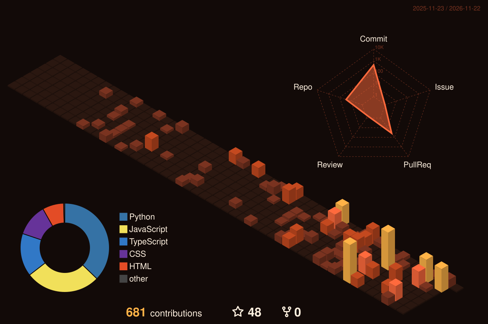


</div>


<div align="center">

| Status | Goal |
|:---:|---|
| ✅ Cleared | Learn programming fundamentals |
| ✅ Cleared | Build real-world AI + full stack projects |
| ✅ Cleared | Compete in national-level hackathons (SIH, HackerRank Orchestrate) |
| ⚔️ In progress | Deepen DSA & system design |
| ⚔️ In progress | Ship CAMPAIGNIX and VIVORA to production |
| ⚔️ In progress | Contribute to open source |
| ⚔️ In progress | Land a top-tier SDE internship |

</div>


<div align="center">


<a href="https://anurag-six.vercel.app/"></a>
<a href="https://github.com/Anu7276"></a>
<a href="https://linkedin.com/in/anurag-verma4"></a>


</div>
